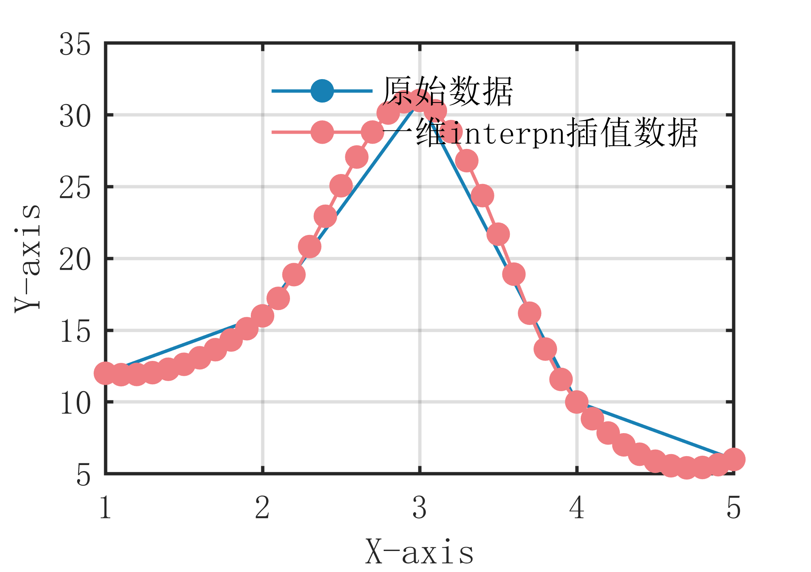

# MATLAB | Interpolation Algorithm | One-Dimensional Interpolation Method | Included data and plotting code | Directly Useable

1. Basic Definition of One-Dimensional Interpolation Algorithm
The principle of the one-dimensional interpolation algorithm is to calculate the function value at any point by interpolating between known n-dimensional data points. The specific algorithmic steps are as follows:
Input a set of known n-dimensional discrete data points, where _ is the independent variable and _ is the dependent variable, and so on.
Sort the data points based on their _ values in ascending order.
For the given interpolation point _, find the interval _ such that _.
Use the straight line between the known points to estimate the function value of the interpolation point _, according to the formula _.
Output the function value of the interpolation point _. The core idea of the one-dimensional interpolation algorithm is to perform linear interpolation between known n-dimensional data points, using the straight line between the known points to estimate the function value of the unknown point. The entire algorithm process is slightly more complex than the one-dimensional interpl interpolation algorithm, considering interactions among multiple independent variables, but it remains a simple, easy-to-understand, and fast interpolation method. Of course, if there are nonlinear relationships between the data points, higher-order interpolation methods need to be used to achieve higher interpolation accuracy.
2. Definition and Outline Effects
The outline effects are as follows:
\n        \n  
Attach video tutorial for operation:
\n        \n          \n          \n          \n          \n            To view this video please enable JavaScript, and consider upgrading to a\n            web browser that\n            supports HTML5 video\n

## Images

<!-- PAYMENT_BLOCK -->

## Get this dataset

- Payment link (Stripe): [Buy now](https://buy.stripe.com/3cs8yP7sY87d0vu9AB)
- Payment QR code: 

<!-- /PAYMENT_BLOCK -->
